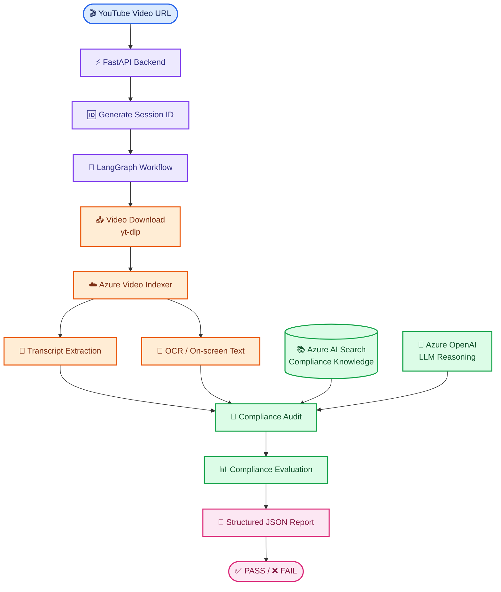
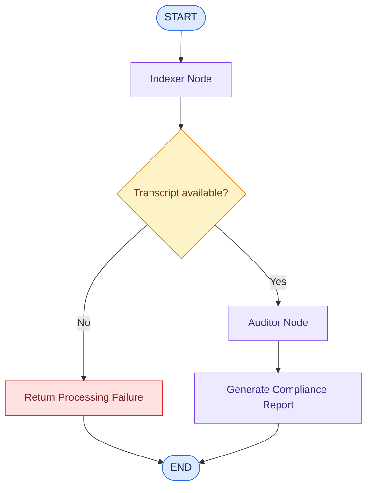
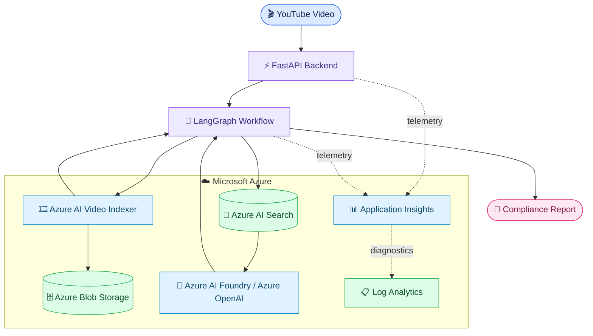

# Video-Complaince-AI-
AI-powered video compliance auditing system using Python, FastAPI, LangGraph, Azure Video Indexer and LLMs to analyze video content for brand safety, policy violations and compliance risks.

# 🎥 Video Compliance AI

<p align="center">
  <strong>AI-Powered Video Compliance & Brand Safety Auditing</strong>
</p>

<p align="center">
  Analyze video content, extract insights, retrieve compliance guidelines, and identify potential brand safety risks using AI.
</p>

<p align="center">
  
  
  
  
  
</p>

<p align="center">
  
  
  
</p>

---

## 🌟 1. What is Video Compliance AI?

**Video Compliance AI** is an AI engineering project designed to automate the analysis of video content against brand safety and compliance guidelines.

Instead of manually reviewing every video, the system aims to create an automated pipeline that:

- Accepts a YouTube video URL.
- Downloads and processes video content.
- Extracts transcripts and on-screen text.
- Retrieves relevant compliance guidelines.
- Uses LLM-based reasoning to analyze content.
- Identifies potential compliance risks.
- Generates a structured audit report.

### 🎯 The problem we are solving

Brands, agencies, and marketing teams publish large volumes of video content. Manually checking every video for policy violations, inappropriate claims, or brand safety concerns can be time-consuming.

This project explores how **video intelligence + retrieval + LLM reasoning + workflow orchestration** can help automate that review process.

---

## 🧠 2. Technology Stack

### Core engineering stack

<p align="center">
  
</p>

| Technology | Role in this project |
|---|---|
| 🐍 Python 3.12 | Core programming language |
| ⚡ FastAPI | REST API and backend services |
| 🔗 LangGraph | Orchestrates the multi-step audit workflow |
| ☁️ Azure Video Indexer | Video insights and transcript extraction |
| 🤖 Azure OpenAI | LLM-powered compliance analysis |
| 🔎 Azure AI Search | Retrieval of compliance knowledge |
| 📥 yt-dlp | YouTube video download integration |
| 📖 Swagger UI | API documentation and testing |
| 📦 uv | Python dependency and environment management |

### AI and retrieval components

```text
Video Content
     |
     v
Transcript + OCR Extraction
     |
     v
Compliance Knowledge Retrieval
     |
     v
LLM-Based Reasoning
     |
     v
Structured Compliance Findings
```

---

## 🏗️ 3. System Architecture

The application is designed around a modular workflow, with FastAPI accepting requests and LangGraph coordinating the processing and auditing stages.



### 🔍 Architecture explained in simple terms

| Stage | What happens? |
|---|---|
| 1. Input | User submits a YouTube video URL |
| 2. API | FastAPI receives the request |
| 3. Workflow | LangGraph coordinates processing |
| 4. Video intelligence | Azure Video Indexer processes the video |
| 5. Extraction | Transcript and OCR information are collected |
| 6. Retrieval | Relevant compliance knowledge is retrieved |
| 7. AI analysis | LLM evaluates content against guidelines |
| 8. Output | Structured compliance results are returned |

---

## 🔄 4. LangGraph Workflow

The workflow separates video processing from compliance analysis.



**Why LangGraph?**

It provides explicit workflow orchestration, state management, and separation of processing and auditing responsibilities.

---

## 📡 5. API Documentation

The backend exposes REST API endpoints through FastAPI.

| Method | Endpoint | Purpose |
|---|---|---|
| GET | `/health` | Check API health |
| POST | `/audit` | Submit a video for auditing |
| GET | `/docs` | Interactive Swagger documentation |

### Example API request

```http
POST /audit
Content-Type: application/json
```

```json
{
  "video_url": "https://www.youtube.com/watch?v=YOUR_VIDEO_ID"
}
```

### Example response structure

```json
{
  "session_id": "unique-session-id",
  "video_id": "video-id",
  "status": "FAIL",
  "final_report": "Audit skipped because video processing failed (No Transcript).",
  "compliance_results": []
}
```

This is an example of the **actual initial failure state** observed during development. A successful response will be documented after the complete pipeline is verified.

---
## ☁️ Azure Cloud Infrastructure

The project uses Microsoft Azure services to support video processing, AI-powered analysis, knowledge retrieval, data storage, and application monitoring.

### Azure Resources

| Azure Service | Responsibility |
|---|---|
| Azure AI Video Indexer | Video insights, transcript and OCR extraction |
| Azure AI Foundry | AI model and project environment |
| Azure OpenAI | LLM-powered compliance reasoning |
| Azure AI Search | Compliance knowledge indexing and retrieval |
| Azure Blob Storage | Cloud object storage |
| Application Insights | Application telemetry and performance monitoring |
| Log Analytics Workspace | Centralized logs and diagnostics |

### Cloud Architecture



*The diagram represents the intended service architecture. Actual data flow and production integration are subject to end-to-end verification.*

### Infrastructure Provisioning Status

- [x] Azure resource group created
- [x] Azure Storage Account provisioned
- [x] Azure AI Foundry resource provisioned
- [x] Azure AI Search service provisioned
- [x] Azure AI Video Indexer resource provisioned
- [x] Application Insights provisioned
- [x] Log Analytics Workspace available
- [x] Azure ARM authentication tested
- [ ] Verify complete Video Indexer account-token and upload integration
- [ ] Verify end-to-end cloud processing
- [ ] Deploy and validate the application in Azure

### Observability

Application Insights is configured for application telemetry, while Log Analytics provides a workspace for centralized diagnostics.

The objective is to make application behavior, processing failures, and performance easier to investigate during production deployment.

## 🖥️ 6. Running the Project Locally

### Prerequisites

- Python 3.12
- uv package manager
- Azure service resources and credentials
- Git

### Step 1 — Clone the repository

```bash
git clone https://github.com/Disha-pro/video-compliance-ai.git
cd video-compliance-ai
```

### Step 2 — Set up the environment

```bash
uv sync --python 3.12
```

### Step 3 — Configure environment variables

Create a local `.env` file based on `.env.example`.

Configure the required Azure credentials and service endpoints.

**Important:** Never commit your real `.env` file or API keys.

### Step 4 — Start FastAPI

PowerShell:

```powershell
$env:PYTHONPATH = "$PWD\backend"

uv run --python 3.12 uvicorn backend.src.api.server:app --reload --app-dir backend
```

### Step 5 — Open Swagger UI

```text
http://127.0.0.1:8000/docs
```

### Step 6 — Test the API

1. Expand `POST /audit`.
2. Click **Try it out**.
3. Enter a valid YouTube video URL.
4. Click **Execute**.
5. Inspect the response and terminal logs.

---

## 📈 7. Development Progress

This project is being developed and tested incrementally.

```mermaid
flowchart LR
    A["Environment Setup"] --> B["FastAPI Backend"]
    B --> C["Swagger API"]
    C --> D["Azure Authentication"]
    D --> E["Video Processing"]
    E --> F["Transcript Extraction"]
    F --> G["Compliance Analysis"]
    G --> H["Final Report"]

    classDef done fill:#dcfce7,stroke:#16a34a,color:#14532d
    classDef active fill:#fef3c7,stroke:#d97706,color:#78350f
    classDef planned fill:#e5e7eb,stroke:#64748b,color:#1e293b

    class A,B,C,D done
    class E,F active
    class G,H planned
```



| Component | Current status |
|---|---|
| Python environment | ✅ Configured |
| Dependencies | ✅ Installed |
| FastAPI server | ✅ Running |
| Swagger documentation | ✅ Available |
| API health endpoint | ✅ Operational |
| Azure ARM token acquisition | ✅ Verified |
| Azure AI Search indexing and retrieval | ✅ Tested |
| Video Indexer account-token integration | 🔄 Under testing |
| Complete transcript extraction | 🔄 Under testing |
| End-to-end compliance audit | ⏳ Pending verification |

---

## 🚀 8. Planned Enhancements

- [ ] Complete Azure Video Indexer integration.
- [ ] Verify transcript and OCR extraction.
- [ ] Complete end-to-end LangGraph execution.
- [ ] Add compliance scoring and severity levels.
- [ ] Add evidence-based violation reporting.
- [ ] Build an interactive audit dashboard.
- [ ] Add background processing and audit status tracking.
- [ ] Deploy the application to Azure.
- [ ] Add automated tests and production monitoring.

---

## 🔐 9. Security Considerations

- Store credentials in environment variables.
- Exclude `.env` from Git.
- Apply least-privilege Azure permissions.
- Avoid publishing confidential video content.
- Validate incoming URLs and uploaded content.
- Apply appropriate API authentication before production deployment.

---

## 👩‍💻 10. About the Developer

**Disha Sonkar**

AI Engineering | Generative AI | Agentic AI | Data Analytics

Building practical AI systems that combine backend engineering, retrieval-augmented generation, workflow orchestration, and LLM-based automation.

<p align="center">
  <a href="https://github.com/Disha-pro">
    
  </a>
</p>

---

<p align="center">
  <strong>Video Compliance AI</strong><br/>
  From Video Intelligence to Automated Compliance Reasoning.
</p>
